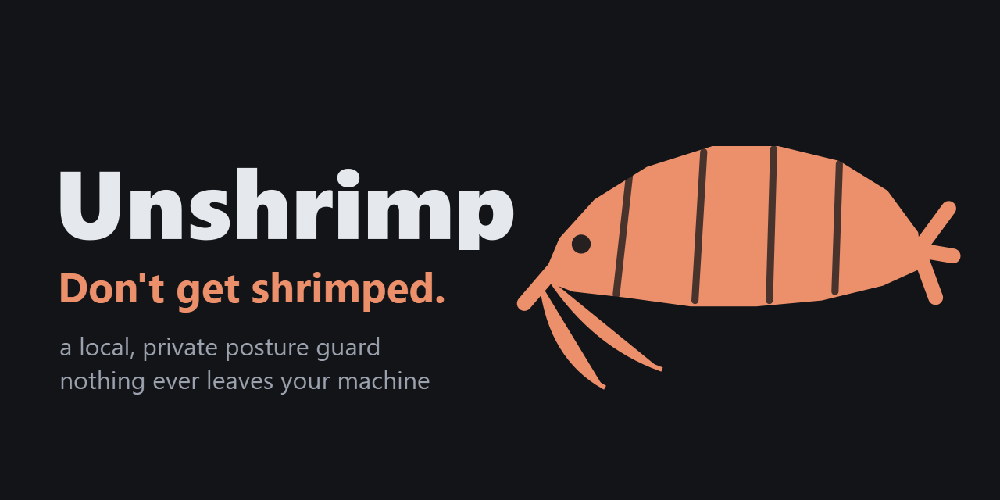

<p align="center"></p>

# Unshrimp

**Don't get shrimped.** A local, private posture guard for people with forward head posture and thoracic hunching. Unshrimp watches your webcam (fully on-device, 2 fps) — or slows to 1 fps when you're sitting fine, or speeds to 4 the moment you start sinking — compares your head/neck/shoulder geometry against **your own calibrated baseline**, and when you slouch… **a very large shrimp fades in at the bottom of your screen.** You are the shrimp. Uncurl.

> Nothing ever leaves your machine.

## Download

**Windows:** grab `unshrimp-win64.zip` from [**Releases**](https://github.com/msb090219/unshrimp/releases), unzip, and double-click **`unshrimp.exe`**. No Python or installs needed; the posture models ship inside the zip. After unzipping, right-click the exe → Properties → tick **Unblock** to stop the "downloaded from the internet" prompt on every launch (the binaries are unsigned).

**macOS:** not packaged right now — known first-run UI issues are being fixed. Brave souls can run from source (below).

First-run heads-ups: Windows may show SmartScreen (*More info* → *Run anyway*), and the OS will ask for **camera permission** — that's the whole app; grant it.

## How to use

1. **Calibrate** (tray menu → *Calibrate…*, or just double-click the HUD) — a guided ~50 s flow with a live **camera preview** docked below the bar (drag either; they travel as a pair):
   - **Setup check** — Unshrimp validates your *camera*: level, height vs. your gaze, framing, lighting. The HUD shows which check is failing and how to fix it.
   - **Sit tall** (~10 s) → **Sit normal** (~8 s, becomes your scoring anchor) → **Hunch** (~6 s, defines where "red" is, per signal, for your body) → **Verify** (~12 s, Unshrimp proves your normal scores green before trusting itself).
2. **Live**: the HUD's ten little shrimp light up green → amber → red, and the tray shrimp tints with your state. **A large translucent shrimp rises from the bottom of the screen as you sink** — faint while drifting, big and gently bobbing when hunched. It fades away the moment you sit tall. Right-click the HUD or left-click the tray for menus; double-click the HUD to open Settings.
3. **Nudges**: sustained hunching (45 s default) → toast, politely re-nagged until you recover.
4. **Life happens**: leave the desk and scoring pauses (grey). **Pause for meetings stops the camera completely** — light off, zero power. Recalibrate whenever your setup changes.
5. **Stretch breaks** every 40 min (configurable): chin tucks, thoracic extensions, wall angels, doorway pec stretch, scapular squeezes — editable list.
6. **Stats**: Settings → Stats — today's % good posture and a 7-day chart.

## Privacy

- **No cloud. No accounts. No telemetry.**
- All pose estimation runs on-device via MediaPipe.
- **No frames, images, or video are ever written to disk** — only anonymous landmark coordinates in memory.
- Posture history lives in `%APPDATA%\Unshrimp` (a small SQLite file), outside this repo, and is never uploaded anywhere.

## Dev setup

Requires Python 3.10+. Windows is the primary platform; macOS works from source.

```bash
python -m venv .venv
.venv\Scripts\pip install -r requirements-dev.txt   # macOS/Linux: .venv/bin/pip
.venv\Scripts\pip install -e .                      # makes `unshrimp` importable for tests
.venv\Scripts\python fetch_models.py                # ~16 MB of MediaPipe models, one time
.venv\Scripts\python main.py                        # the app; or vision_demo.py for a console demo
.venv\Scripts\pytest                                # 53 unit tests
```

**macOS from source:** same steps; first camera open triggers the *"Terminal would like to access the camera"* prompt — Allow. Chime falls back to the system beep; the start-with-OS setting is hidden (add to Login Items manually).

**Troubleshooting:** the HUD bar has a right-click menu with everything the tray menu has. If something misbehaves, the run log at `%APPDATA%\Unshrimp\unshrimp.log` (Windows) or `~/Library/Application Support/Unshrimp/unshrimp.log` (macOS) is the file to attach to a bug report.

## How it works

Three scale-invariant signals, normalized by your inter-shoulder width:

| Signal | Catches |
|---|---|
| `head_pitch` | chin dropping toward the screen |
| `head_sink` | ears sinking toward shoulders as you collapse |
| `lean_in` | face-to-shoulder ratio climbing as you poke toward the monitor |

Calibration anchors scoring at your measured *normal* posture with the hunch sample setting the red distance (see `unshrimp/core/calibration.py`). Rolling-median smoothing and a head-turn gate keep normal movement from crying wolf; the verify phase auto-tunes until your normal reads green.

## Designing for Unshrimp

All built-in art is drawn in code, but **designed art wins**: drop PNGs into `assets/brand/` per [ASSETS.md](ASSETS.md) and the app picks them up — no code, no rebuild.

## Disclaimer

Unshrimp is a habit nudge, not a medical device. If you have neck/thoracic issues, pair it with proper physiotherapy.

## License

[MIT](LICENSE)
